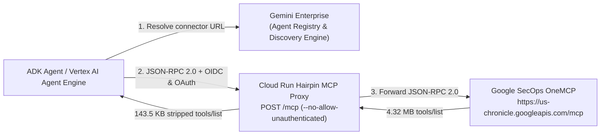

# Gemini Enterprise Hairpin MCP Proxy for Google SecOps

When you connect an Agent Development Kit (ADK) agent or Gemini Enterprise connector directly to the Google Security Operations OneMCP server at `https://us-chronicle.googleapis.com/mcp`, the `tools/list` response returns 71 tools totaling 4.32 MB of JSON (`3.91 MB` of `outputSchema` and `258 KB` of `inputSchema`).

When ADK converts those MCP tool definitions into Gemini function declarations, it passes both `inputSchema` and `outputSchema` to Vertex AI. Vertex AI rejects the request with `400 INVALID_ARGUMENT` because the combined schemas exceed the model's schema state limit.

This repository provides a **Hairpin MCP Proxy** on Cloud Run that unblocks using Gemini Enterprise MCP connectors with Google SecOps OneMCP:
1. **Strips bloated schemas server-side**: Forwards JSON-RPC 2.0 requests to `https://us-chronicle.googleapis.com/mcp`, removes `outputSchema` from `tools/list`, and replaces `inputSchema` with an open object stub (`{"type": "object", "additionalProperties": true}`).
2. **Reduces `tools/list` payload by 96.68%**: Shrinks the `tools/list` payload from `4,315,369 bytes` (`4.32 MB`) to `143,464 bytes` (`143.5 KB`) while preserving all 71 tool names, descriptions, and annotations.
3. **Registers as a Gemini Enterprise connector**: Registers in Discovery Engine as a `custom_mcp` (`BYO_MCP`) connector and syncs automatically to the Gemini Enterprise Agent Registry catalog.
4. **Enforces Cloud Run IAM (`--no-allow-unauthenticated`)**: Requires `roles/run.invoker` with an OIDC ID token in `Authorization` while forwarding the caller's OAuth 2.0 access token to OneMCP via `X-Forwarded-Authorization`.



---

## Quickstart: Repeat the Hairpin MCP setup

### 1. Initialize local environment

```bash
just setup
direnv allow .
```

Update `.env` with your `GCP_PROJECT_ID`, `GCP_PROJECT_NUMBER`, and `CHRONICLE_CUSTOMER_ID`.

### 2. Deploy the Hairpin MCP proxy to Cloud Run

Deploy the FastAPI proxy (`src/gement_mcp_tool_filter_poc/hairpin.py`) to Cloud Run with `--no-allow-unauthenticated`:

```bash
SERVICE_NAME="secops-hairpin-mcp"
just deploy-cloud-run "$SERVICE_NAME"
```

### 3. Configure IAM and Cloud Run invoker bindings

Grant the required Discovery Engine, Agent Registry, Chronicle, Vertex AI, and `roles/run.invoker` permissions to your caller identity and the runtime service agents:

```bash
ACCOUNT="user@example.com"
SERVICE_NAME="secops-hairpin-mcp"
just setup-iam "$ACCOUNT" "$SERVICE_NAME"
```

Retrieve the deployed Cloud Run URL and set `HAIRPIN_MCP_URL` in `.env`:

```bash
PROJECT_ID="your-gcp-project-id"
REGION="us-central1"
SERVICE_NAME="secops-hairpin-mcp"
SERVICE_URL="$(gcloud run services describe "$SERVICE_NAME" --project="$PROJECT_ID" --region="$REGION" --format='value(status.url)')"
HAIRPIN_MCP_URL="${SERVICE_URL}/mcp"
echo "HAIRPIN_MCP_URL=$HAIRPIN_MCP_URL"
```

### 4. Register the Hairpin MCP connector in Gemini Enterprise

Register the Cloud Run `/mcp` endpoint as a `custom_mcp` (`BYO_MCP`) connector in Discovery Engine (`collections:setUpDataConnector`):

```bash
HAIRPIN_MCP_URL="https://secops-hairpin-mcp-123456789012.us-central1.run.app/mcp"
just register-connector --hairpin-url "$HAIRPIN_MCP_URL"
```

Verify that the connector is synced into Gemini Enterprise Agent Registry:

```bash
just list-connectors
```

### 5. Run the ADK agent locally or deploy to Vertex AI Agent Engine

Run a test prompt locally against the registered Gemini Enterprise Hairpin MCP connector:

```bash
just run-agent "What SecOps tools do you have access to?"
```

Deploy the unmodified ADK agent to Vertex AI Agent Engine (Reasoning Engine):

```bash
DISPLAY_NAME="secops-hairpin-mcp-vanilla-agent"
just deploy-reasoning-engine --display-name "$DISPLAY_NAME"
```

---

## Documentation

- [Customer guide: Deploying a Hairpin MCP proxy for Gemini Enterprise (`docs/hairpin_mcp_deployment_guide.md`)](./docs/hairpin_mcp_deployment_guide.md)
- [Deployment inventory, IAM bindings, and verification runbook (`docs/deployment.md`)](./docs/deployment.md)

---

## Repository structure

```text
.
├── .env.example          # Environment variable template
├── Dockerfile            # Cloud Run container definition for the Hairpin MCP proxy
├── AGENTS.md             # Repository coding standards (Google Python Style Guide)
├── justfile              # Task runner recipes
├── pyproject.toml        # Project dependencies and Pyink/Ruff/Pytype config
├── docs/
│   ├── deployment.md                   # Deployment inventory and verification runbook
│   └── hairpin_mcp_deployment_guide.md # Standalone step-by-step customer guide
├── src/
│   └── gement_mcp_tool_filter_poc/
│       ├── agent.py      # Gemini Enterprise connector resolution & ADK agent factory
│       ├── cli.py        # Typer + Rich CLI
│       ├── hairpin.py    # Cloud Run Hairpin MCP proxy server
│       └── server.py     # ASGI entrypoint for Cloud Run (uvicorn)
└── tests/
    ├── test_connectors.py # Unit tests for connector discovery and registration
    └── test_hairpin.py    # Unit tests for schema stripping and proxy endpoints
```

---

## Just recipes reference

| Recipe | Description |
| :--- | :--- |
| `just setup` | Create `.env` from template and sync `uv` dependencies |
| `just sync` | Synchronize virtual environment with lockfile |
| `just deploy-cloud-run [service_name]` | Deploy the Hairpin MCP proxy to Cloud Run (`--no-allow-unauthenticated`) |
| `just setup-iam [account] [service_name]` | Configure GCP project IAM roles and Cloud Run `roles/run.invoker` bindings |
| `just register-connector` | Register the Cloud Run Hairpin MCP proxy in Gemini Enterprise Discovery Engine |
| `just list-connectors` | List Gemini Enterprise MCP connectors in table view |
| `just list-connectors-json` | List MCP connectors in JSON format |
| `just run-agent [prompt]` | Run the vanilla ADK agent locally against the Hairpin MCP connector |
| `just deploy-reasoning-engine` | Deploy the vanilla ADK agent to Vertex AI Agent Engine |
| `just test` | Run pytest unit test suite |
| `just format` | Format code in-place with Pyink (2 spaces, 80 columns) |
| `just lint` | Run Ruff checks and Pyink format verification |
| `just typecheck` | Run Google Pytype static type analysis |
| `just clean` | Remove caches, coverage reports, and build artifacts |
