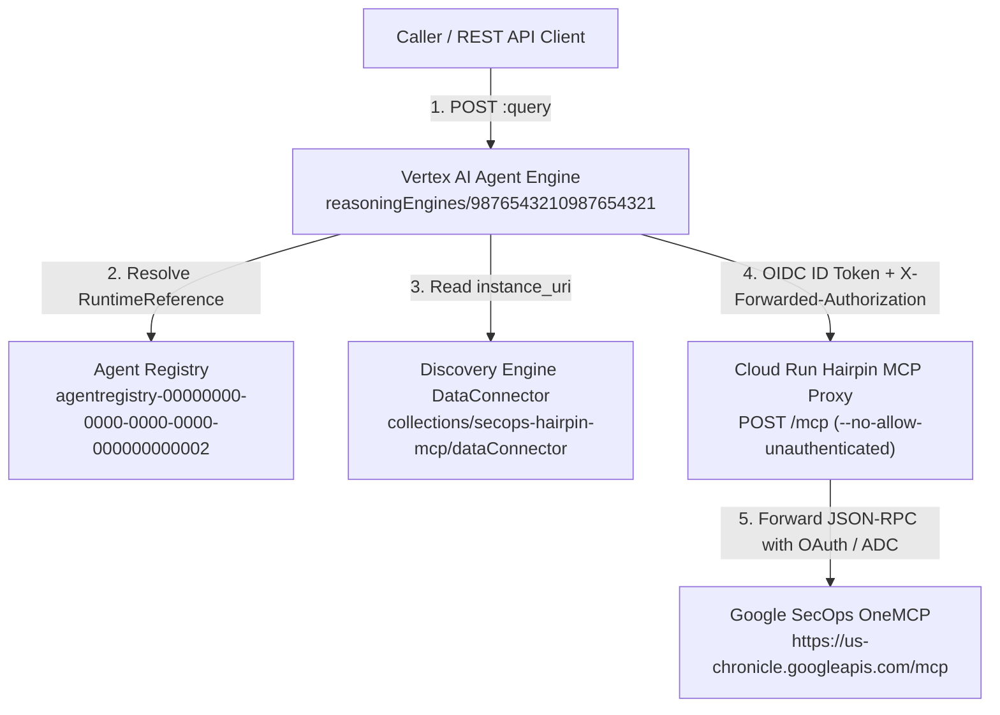

# Deployment inventory and verification runbook

This document records the Google Cloud resources and verification commands for deploying the Hairpin MCP proxy on Cloud Run, registering it as a Gemini Enterprise connector in Discovery Engine, and invoking it from Vertex AI Agent Engine.

---

## 1. Deployed resource reference

| Component | Resource Name / URL | Details |
| :--- | :--- | :--- |
| **GCP Project** | `your-gcp-project-id` (`123456789012`) | Primary project hosting Cloud Run, Discovery Engine, Agent Registry, and Vertex AI Agent Engine |
| **Chronicle Instance** | `00000000-0000-0000-0000-000000000000` (`us`) | Target Google SecOps SIEM and SOAR customer instance |
| **Cloud Run Service** | `secops-hairpin-mcp` (`us-central1`) | Deployed with `--no-allow-unauthenticated` (`https://secops-hairpin-mcp-123456789012.us-central1.run.app`) |
| **Hairpin MCP Endpoint** | `https://secops-hairpin-mcp-123456789012.us-central1.run.app/mcp` | Proxies `https://us-chronicle.googleapis.com/mcp` (`71` tools, `143,464 B`, `-96.52%` vs `4.13 MB` raw) |
| **Hairpin Stats Endpoint** | `https://secops-hairpin-mcp-123456789012.us-central1.run.app/stats` | Live payload size comparison endpoint |
| **Discovery Engine Connector (Hairpin)** | `projects/123456789012/locations/global/collections/secops-hairpin-mcp/dataConnector` | Registered `custom_mcp` (`BYO_MCP`) connector pointing to the Cloud Run Hairpin MCP endpoint |
| **Agent Registry MCP Server (Hairpin)** | `projects/your-gcp-project-id/locations/global/mcpServers/agentregistry-00000000-0000-0000-0000-000000000002` | Synced Agent Registry catalog entry for `secops-hairpin-mcp` |
| **Vertex AI Agent Engine** | `projects/123456789012/locations/us-central1/reasoningEngines/9876543210987654321` | Display name: `secops-hairpin-mcp-vanilla-agent` |
| **GCS Staging Bucket** | `gs://your-gcp-project-id-agent-engine-staging` | Staging bucket for Vertex AI Agent Engine artifacts |

---

## 2. End-to-end request flow



---

## 3. Required IAM bindings

### Cloud Run default compute service account
`123456789012-compute@developer.gserviceaccount.com` executes outbound requests from the Cloud Run Hairpin MCP proxy to `https://us-chronicle.googleapis.com/mcp` when the caller does not pass an explicit `ya29.*` OAuth access token:

```bash
PROJECT_ID="your-gcp-project-id"
CLOUD_RUN_SA="serviceAccount:123456789012-compute@developer.gserviceaccount.com"

gcloud projects add-iam-policy-binding "$PROJECT_ID" \
  --member="$CLOUD_RUN_SA" \
  --role="roles/chronicle.viewer" \
  --condition=None
```

### Vertex AI Reasoning Engine service agent
`service-123456789012@gcp-sa-aiplatform-re.iam.gserviceaccount.com` executes inside the Vertex AI Agent Engine runtime (`9876543210987654321`) to resolve the connector metadata from Agent Registry and Discovery Engine and invoke Gemini:

```bash
PROJECT_ID="your-gcp-project-id"
RE_SERVICE_AGENT="serviceAccount:service-123456789012@gcp-sa-aiplatform-re.iam.gserviceaccount.com"

for ROLE in \
  "roles/aiplatform.user" \
  "roles/agentregistry.viewer" \
  "roles/discoveryengine.viewer" \
  "roles/chronicle.viewer" \
  "roles/mcp.toolUser"; do
  gcloud projects add-iam-policy-binding "$PROJECT_ID" \
    --member="$RE_SERVICE_AGENT" \
    --role="$ROLE" \
    --condition=None
done
```

### Cloud Run service invoker bindings (`--no-allow-unauthenticated`)
`secops-hairpin-mcp` is deployed with `--no-allow-unauthenticated`. Only authorized principals with `roles/run.invoker` can invoke the Cloud Run Hairpin MCP proxy:

```bash
PROJECT_ID="your-gcp-project-id"
PROJECT_NUMBER="123456789012"
REGION="us-central1"
SERVICE_NAME="secops-hairpin-mcp"
CALLER_ACCOUNT="user@example.com"

for MEMBER in \
  "user:${CALLER_ACCOUNT}" \
  "serviceAccount:${PROJECT_NUMBER}-compute@developer.gserviceaccount.com" \
  "serviceAccount:service-${PROJECT_NUMBER}@gcp-sa-aiplatform-re.iam.gserviceaccount.com" \
  "serviceAccount:service-${PROJECT_NUMBER}@gcp-sa-discoveryengine.iam.gserviceaccount.com"; do
  gcloud run services add-iam-policy-binding "$SERVICE_NAME" \
    --project="$PROJECT_ID" \
    --region="$REGION" \
    --member="$MEMBER" \
    --role="roles/run.invoker"
done
```

---

## 4. Deployment commands

### Step 1: Deploy the Cloud Run Hairpin MCP service and configure IAM

```bash
SERVICE_NAME="secops-hairpin-mcp"
CALLER_ACCOUNT="user@example.com"
direnv exec . just deploy-cloud-run "$SERVICE_NAME"
direnv exec . just setup-iam "$CALLER_ACCOUNT" "$SERVICE_NAME"
```

### Step 2: Register the Hairpin MCP connector in Gemini Enterprise

```bash
HAIRPIN_MCP_URL="https://secops-hairpin-mcp-123456789012.us-central1.run.app/mcp"
direnv exec . just register-connector --hairpin-url "$HAIRPIN_MCP_URL"
```

### Step 3: Deploy the vanilla agent to Vertex AI Agent Engine

```bash
direnv exec . just deploy-reasoning-engine
```

---

## 5. Verification commands

### Check Cloud Run Hairpin MCP health and payload stats

Cloud Run reserves `/healthz`, so the proxy serves its health check at `/health` (and `/`). `/stats` reports byte counts measured with the same compact JSON encoding the `/mcp` endpoint uses, so `input_and_output_schema_stripped_bytes` equals the size of the proxied `tools/list` response body:

```bash
SERVICE_URL="https://secops-hairpin-mcp-123456789012.us-central1.run.app"
ID_TOKEN="$(direnv exec . gcloud auth print-identity-token)"
curl -s -H "Authorization: Bearer ${ID_TOKEN}" "${SERVICE_URL}/health" | jq .
curl -s -H "Authorization: Bearer ${ID_TOKEN}" "${SERVICE_URL}/stats" | jq .
```

Expected output:

```json
{
  "status": "ok",
  "service": "secops-hairpin-mcp",
  "upstream_url": "https://us-chronicle.googleapis.com/mcp",
  "default_project_id": "your-gcp-project-id"
}
{
  "tool_count": 71,
  "raw_tools_list_bytes": 4125239,
  "output_schema_stripped_bytes": 386818,
  "input_and_output_schema_stripped_bytes": 143464,
  "reduction_bytes": 3981775,
  "reduction_percent": 96.52
}
```

### Query the deployed Vertex AI Agent Engine instance

```bash
PROJECT_NUMBER="123456789012"
REGION="us-central1"
REASONING_ENGINE_ID="9876543210987654321"
QUERY_URL="https://${REGION}-aiplatform.googleapis.com/v1beta1/projects/${PROJECT_NUMBER}/locations/${REGION}/reasoningEngines/${REASONING_ENGINE_ID}:query"

curl -s -X POST \
  -H "Authorization: Bearer $(direnv exec . gcloud auth print-access-token)" \
  -H "Content-Type: application/json" \
  "$QUERY_URL" \
  -d '{
    "classMethod": "query",
    "input": {
      "prompt": "Use list_rules to list 2 detection rules in project your-gcp-project-id, customer 00000000-0000-0000-0000-000000000000, region us. Report the rule displayName and severity, and confirm whether create_feed is also present in your available tools."
    }
  }'
```

Verified response:

```json
{
  "output": "Here are the details for the 2 detection rules:\n\n1.  **Rule Display Name:** `producer_recon_environment_enumeration_network_cisa_report`\n    **Severity:** `Low`\n2.  **Rule Display Name:** `high_risk_user_download_executable_from_macro`\n    **Severity:** `High`\n\nYes, `create_feed` is present in my available tools."
}
```
