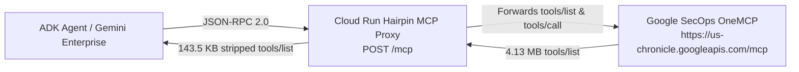

# Hairpin MCP proxy for Gemini Enterprise: companion guide

This guide explains what the repository deploys and what each `just` recipe in the [README quickstart](../README.md#quickstart-repeat-the-hairpin-mcp-setup) does underneath, so you can review the design, port the steps into your own automation, or troubleshoot a step that fails. The recipes are the supported path; the `gcloud`, REST, and Python calls below are the same operations written out. The proxy has exactly one implementation, [`src/secops_hairpin_mcp/hairpin.py`](../src/secops_hairpin_mcp/hairpin.py), and every section refers back to it.

## Why a proxy

When an agent connects directly to the Google Security Operations OneMCP server at `https://us-chronicle.googleapis.com/mcp`, the `tools/list` response returns 71 tools totaling 4.13 MB of JSON. Of that payload, 3.74 MB is `outputSchema` and 243 KB is `inputSchema`. When the Agent Development Kit (ADK) converts those tools into Gemini function declarations, it sends both schemas to Vertex AI, which rejects the request with `400 INVALID_ARGUMENT` because the combined schemas exceed its schema limit.

The Hairpin MCP proxy sits between the agent and OneMCP on Cloud Run. It forwards JSON-RPC 2.0 requests unchanged except for `tools/list`, where it strips `outputSchema` and replaces `inputSchema` with a minimal open object. The payload drops from 4.13 MB to 143.5 KB with all 71 tool names and descriptions intact, and the Cloud Run URL is registered as a `custom_mcp` connector in Gemini Enterprise. No client-side tool wrappers or filtering are involved.



---

## 1. What the proxy does

The service is one FastAPI application, `hairpin_app` in [`hairpin.py`](../src/secops_hairpin_mcp/hairpin.py), which [`server.py`](../src/secops_hairpin_mcp/server.py) exposes as `app` for uvicorn (the `CMD` in the [Dockerfile](../Dockerfile)).

### Routes

| Route | Purpose |
| :--- | :--- |
| `POST /mcp` | MCP Streamable HTTP endpoint. Accepts one JSON-RPC 2.0 object or a batch array. Query flags `strip_input` and `strip_output` default to `true`; set either to `false` to compare against the raw upstream payload. |
| `POST /` | Alias for `POST /mcp` for clients that cannot append a path. |
| `GET /health`, `GET /` | Status JSON (`status`, `service`, `upstream_url`, `default_project_id`). Served at `/health` rather than `/healthz` because Cloud Run answers `/healthz` at its frontend without reaching the container. |
| `GET /stats` | Byte counts for the raw, output-stripped, and fully stripped `tools/list` payloads, measured with the same compact JSON encoding that `/mcp` sends, so the figures equal the bytes on the wire. |

### Request handling (`HairpinMcpProxy.forward_jsonrpc`)

- `notifications/*` messages are acknowledged with HTTP 202 and no body.
- `ping` is answered locally.
- `tools/list` is fetched from OneMCP and cached in the container for 300 seconds (`DEFAULT_CACHE_TTL_SECONDS`); the cache is shared by every caller of that container instance. `sanitize_tools_list_response` then removes `outputSchema` from each tool and replaces `inputSchema` with `{"type": "object", "additionalProperties": true}`, the smallest schema that still passes the MCP client's `Tool` validation. Names, descriptions, and annotations are untouched, and Gemini infers call arguments from the descriptions.
- Every other method (`initialize`, `tools/call`, and so on) is forwarded verbatim and the upstream response is returned as is. `tools/call` is never cached.

### Credentials on the upstream call (`HairpinMcpProxy._resolve_oauth_bearer`)

The proxy chooses the OAuth 2.0 token it presents to OneMCP in this order:

1. `X-Forwarded-Authorization: Bearer <access token>`, the caller's own token. The ADK agent, the Agent Engine class, and the verification commands send this header.
2. `Authorization: Bearer <token>` when the token is not a JWT. OIDC ID tokens start with `eyJ` and are meant for Cloud Run IAM, not OneMCP, so they are never forwarded.
3. Application Default Credentials of the Cloud Run runtime service account.

`x-goog-user-project` is passed through from the request or defaults to `GCP_PROJECT_ID`; `Mcp-Session-Id` is forwarded unchanged. Step 3 is why `just setup-iam` grants the default compute service account `roles/chronicle.viewer`, and why the invoker list should stay short (see the README security notes).

### Configuration

| Variable | Default | Set by |
| :--- | :--- | :--- |
| `UPSTREAM_ONEMCP_URL` | `https://us-chronicle.googleapis.com/mcp` | `just deploy-cloud-run` (`--set-env-vars`) |
| `GCP_PROJECT_ID` | `your-gcp-project-id` | `just deploy-cloud-run` (`--set-env-vars`) |
| `PORT` | `8080` | Dockerfile; Cloud Run sets it at runtime |

### Container and tests

The [Dockerfile](../Dockerfile) starts from `python:3.11-slim`, copies `uv` at the version that produced `uv.lock`, runs `uv sync --no-dev` against public PyPI, and starts `uvicorn secops_hairpin_mcp.server:app`. Cloud Build builds it from the repository root during `gcloud run deploy --source=.`.

[`tests/test_hairpin.py`](../tests/test_hairpin.py) pins the two invariants: every tool in a proxied `tools/list` has the stub `inputSchema` and no `outputSchema`, and the `/stats` stripped size equals the length of the `/mcp` response body.

---

## 2. Variables used in this guide

```bash
PROJECT_ID="your-gcp-project-id"
PROJECT_NUMBER="$(gcloud projects describe "$PROJECT_ID" --format='value(projectNumber)')"
REGION="us-central1"
SERVICE_NAME="secops-hairpin-mcp"
COLLECTION_ID="secops-hairpin-mcp"
ACCOUNT="user@example.com"
```

The recipes read the same values from `.env` (`GCP_PROJECT_ID`, `GCP_PROJECT_NUMBER`, `GCP_LOCATION`) or take them as arguments. `direnv allow .` loads `.env` through `.envrc`, which also keeps gcloud configuration and Application Default Credentials in `./.gcloud` (gitignored) and disables client-certificate (mTLS) negotiation. README step 1 covers the local setup and `gcloud auth login "$ACCOUNT" --update-adc`.

---

## 3. Deploy the proxy (`just deploy-cloud-run`)

The recipe runs:

```bash
UPSTREAM_ONEMCP_URL="https://us-chronicle.googleapis.com/mcp"

gcloud run deploy "$SERVICE_NAME" \
  --project="$PROJECT_ID" \
  --region="$REGION" \
  --source=. \
  --clear-base-image \
  --set-env-vars="GCP_PROJECT_ID=${PROJECT_ID},UPSTREAM_ONEMCP_URL=${UPSTREAM_ONEMCP_URL}" \
  --no-allow-unauthenticated
```

`--source=.` uploads the repository to Cloud Build, which builds the Dockerfile and stores the image in the `cloud-run-source-deploy` Artifact Registry repository. `--clear-base-image` opts out of Cloud Run automatic base image updates so the image is exactly what the Dockerfile builds. Arguments after the service name are passed through to `gcloud run deploy` (for example `--service-account` or `--min-instances`).

Read the service URL afterwards:

```bash
SERVICE_URL="$(gcloud run services describe "$SERVICE_NAME" \
  --project="$PROJECT_ID" \
  --region="$REGION" \
  --format='value(status.url)')"
HAIRPIN_MCP_URL="${SERVICE_URL}/mcp"
echo "HAIRPIN_MCP_URL=$HAIRPIN_MCP_URL"
```

---

## 4. IAM (`just setup-iam`)

Three identities receive project roles: the operator account, the default compute service account (the Cloud Run runtime identity, which calls OneMCP when no token is forwarded), and the Vertex AI Agent Engine service agent (`service-${PROJECT_NUMBER}@gcp-sa-aiplatform-re.iam.gserviceaccount.com`, which runs the deployed reasoning engine).

| Role | Why |
| :--- | :--- |
| `roles/discoveryengine.viewer` | Read the connector's `dataConnector` to resolve the proxy URL |
| `roles/agentregistry.viewer` | List and read Agent Registry MCP servers |
| `roles/chronicle.viewer` | Call read-only OneMCP tools. Grant `roles/chronicle.editor` instead if agents will create cases, run parsers, or modify rules |
| `roles/aiplatform.user` | Call Gemini on Vertex AI and query the reasoning engine |
| `roles/mcp.toolUser` | `tools/call` against MCP servers enabled in the project |
| `roles/serviceusage.serviceUsageConsumer` | `serviceusage.services.use`, needed because every call sets `X-Goog-User-Project` |

```bash
for MEMBER in \
  "user:${ACCOUNT}" \
  "serviceAccount:${PROJECT_NUMBER}-compute@developer.gserviceaccount.com" \
  "serviceAccount:service-${PROJECT_NUMBER}@gcp-sa-aiplatform-re.iam.gserviceaccount.com"; do
  for ROLE in \
    roles/discoveryengine.viewer \
    roles/agentregistry.viewer \
    roles/chronicle.viewer \
    roles/aiplatform.user \
    roles/mcp.toolUser \
    roles/serviceusage.serviceUsageConsumer; do
    gcloud projects add-iam-policy-binding "$PROJECT_ID" \
      --member="$MEMBER" --role="$ROLE" --condition=None --quiet
  done
done
```

The same three identities plus the Discovery Engine service agent (`service-${PROJECT_NUMBER}@gcp-sa-discoveryengine.iam.gserviceaccount.com`, so that Gemini Enterprise can reach the IAM-protected service) receive `roles/run.invoker` on the service, and any `allUsers` invoker binding is removed:

```bash
for INVOKER in \
  "user:${ACCOUNT}" \
  "serviceAccount:${PROJECT_NUMBER}-compute@developer.gserviceaccount.com" \
  "serviceAccount:service-${PROJECT_NUMBER}@gcp-sa-aiplatform-re.iam.gserviceaccount.com" \
  "serviceAccount:service-${PROJECT_NUMBER}@gcp-sa-discoveryengine.iam.gserviceaccount.com"; do
  gcloud run services add-iam-policy-binding "$SERVICE_NAME" \
    --project="$PROJECT_ID" --region="$REGION" \
    --member="$INVOKER" --role="roles/run.invoker" --quiet
done

gcloud run services remove-iam-policy-binding "$SERVICE_NAME" \
  --project="$PROJECT_ID" --region="$REGION" \
  --member="allUsers" --role="roles/run.invoker" --quiet
```

The recipe is idempotent and prints a warning for each binding it cannot create instead of stopping. When the first argument is a service account address, it is bound as `serviceAccount:` rather than `user:`.

---

## 5. Register the connector (`just register-connector`)

[`register_hairpin_connector`](../src/secops_hairpin_mcp/agent.py) calls Discovery Engine `setUpDataConnector` with `dataSource: custom_mcp` and `mcp_server_source: BYO_MCP`. Discovery Engine creates a collection holding the data connector and syncs it into the Gemini Enterprise Agent Registry, where it appears as `Custom MCP Server - <collection id>`. The equivalent REST call:

```bash
DISPLAY_NAME="SecOps Hairpin MCP (Schema Stripped)"
ACCESS_TOKEN="$(gcloud auth print-access-token)"

curl -s -X POST \
  "https://discoveryengine.googleapis.com/v1alpha/projects/${PROJECT_ID}/locations/global:setUpDataConnector" \
  -H "Authorization: Bearer ${ACCESS_TOKEN}" \
  -H "Content-Type: application/json" \
  -H "X-Goog-User-Project: ${PROJECT_ID}" \
  -d "{
    \"collectionId\": \"${COLLECTION_ID}\",
    \"collectionDisplayName\": \"${DISPLAY_NAME}\",
    \"dataConnector\": {
      \"dataSource\": \"custom_mcp\",
      \"params\": {\"oauth_access_token\": \"unused\"},
      \"actionConfig\": {
        \"actionParams\": {
          \"auth_type\": \"NO_AUTH\",
          \"instance_uri\": \"${HAIRPIN_MCP_URL}\",
          \"mcp_server_source\": \"BYO_MCP\"
        }
      },
      \"connectorModes\": [\"FEDERATED\", \"ACTIONS\"]
    }
  }"
```

`params.oauth_access_token` is a placeholder because the proxy obtains credentials per request (section 1) rather than from the connector. The call returns a long-running operation; the connector is normally `ACTIVE` within a minute. The CLI options `--collection-id`, `--display-name`, `--project-number`, and `--location` map onto the fields above.

Confirm the connector and its Agent Registry entry (`just list-connectors` reads the same data through the Agent Registry client):

```bash
curl -s \
  "https://discoveryengine.googleapis.com/v1alpha/projects/${PROJECT_ID}/locations/global/collections/${COLLECTION_ID}/dataConnector" \
  -H "Authorization: Bearer ${ACCESS_TOKEN}" \
  -H "X-Goog-User-Project: ${PROJECT_ID}" | jq '{name, state, dataSource, actionConfig}'

curl -s \
  "https://agentregistry.googleapis.com/v1alpha/projects/${PROJECT_ID}/locations/global/mcpServers" \
  -H "Authorization: Bearer ${ACCESS_TOKEN}" \
  -H "X-Goog-User-Project: ${PROJECT_ID}" | jq '.mcpServers[] | {name, displayName}'
```

---

## 6. Use the proxy from ADK (`just run-agent`, `just deploy-reasoning-engine`)

### Endpoint resolution

[`resolve_mcp_endpoint`](../src/secops_hairpin_mcp/agent.py) picks the MCP URL in this order: an explicit `--mcp-url`, then `HAIRPIN_MCP_URL` from `.env`, then the `instance_uri` of the connector named by `MCP_SERVER_NAME` (default `secops-hairpin-mcp`), read from the Discovery Engine `dataConnector` (for `agentregistry-...` names, the collection is looked up through the Agent Registry `RuntimeReference` first). `just run-agent` prints which source it used as `MCP endpoint: <url> (from <source>)`.

### Headers for an IAM-protected Cloud Run endpoint

[`build_mcp_auth_headers(target_url, project_id)`](../src/secops_hairpin_mcp/hairpin.py) returns the headers a client needs. For a `*.run.app` host (or any host outside `*.googleapis.com`) it places a Google-signed OIDC ID token in `Authorization` for Cloud Run IAM and the caller's OAuth 2.0 access token in `X-Forwarded-Authorization` for OneMCP, plus `X-Goog-User-Project`. It takes the ID token from Application Default Credentials first (`gcloud auth login --update-adc` populates it) and only then calls `id_token.fetch_id_token`, which on a Compute Engine VM would return the VM's service-account identity instead of the user's.

### A standard ADK agent

[`create_agent`](../src/secops_hairpin_mcp/agent.py) builds an ordinary `google.adk.agents.Agent` (`gemini-2.5-flash`) with one `McpToolset` whose `header_provider` rebuilds those headers on every call. There is no client-side tool filtering or schema pruning. In your own ADK application:

```python
from secops_hairpin_mcp.agent import create_agent

root_agent = create_agent(
    name="secops_agent",
    project_id="your-gcp-project-id",
    mcp_server_name="secops-hairpin-mcp",
)
```

`just run-agent "<prompt>"` runs exactly this agent with an `InMemoryRunner` and prints the response.

### Vertex AI Agent Engine

`just deploy-reasoning-engine` creates the staging bucket if it is missing (`ensure_staging_bucket`), then calls `vertexai.preview.reasoning_engines.ReasoningEngine.create` with `HairpinVanillaReasoningEngineAgent` from [`cli.py`](../src/secops_hairpin_mcp/cli.py). Agent Engine serializes that class with cloudpickle and installs only the listed `requirements`, so the class carries its own copy of the connector lookup and header logic and resolves the connector URL at query time. Redeploying the proxy therefore never requires redeploying the engine. The `:query` REST call is in [deployment.md section 5](./deployment.md#5-verification-commands).

---

## 7. Verify the proxy

```bash
ID_TOKEN="$(gcloud auth print-identity-token)"
ACCESS_TOKEN="$(gcloud auth print-access-token)"

# Without an ID token Cloud Run returns 403 before the container sees the request.
curl -s -o /dev/null -w "%{http_code}\n" -X POST "$HAIRPIN_MCP_URL" \
  -H "Content-Type: application/json" \
  -d '{"jsonrpc":"2.0","id":1,"method":"ping"}'

# Expected: tools: 71 bytes: 143464
curl -s -X POST "$HAIRPIN_MCP_URL" \
  -H "Authorization: Bearer ${ID_TOKEN}" \
  -H "X-Forwarded-Authorization: Bearer ${ACCESS_TOKEN}" \
  -H "Content-Type: application/json" \
  -d '{"jsonrpc":"2.0","id":1,"method":"tools/list","params":{}}' \
  | python3 -c "import sys, json; raw = sys.stdin.read(); d = json.loads(raw); print('tools:', len(d['result']['tools']), 'bytes:', len(raw))"

# Raw versus stripped sizes as measured inside the proxy
curl -s "${SERVICE_URL}/stats" \
  -H "Authorization: Bearer ${ID_TOKEN}" \
  -H "X-Forwarded-Authorization: Bearer ${ACCESS_TOKEN}" | jq .
```

As of October 2026 the US OneMCP catalog yields `tool_count` 71, `raw_tools_list_bytes` 4125239, `input_and_output_schema_stripped_bytes` 143464, and `reduction_percent` 96.52. The figures move whenever the OneMCP tool catalog changes; the invariant to check is that `input_and_output_schema_stripped_bytes` equals the byte length of the `tools/list` response.

---

## 8. Teardown (`just teardown`)

The recipe deletes, in order:

1. The reasoning engine named by `REASONING_ENGINE_ID` in `.env`, with `DELETE https://${REGION}-aiplatform.googleapis.com/v1beta1/<engine resource name>?force=true` (skipped when the variable is empty).
2. The Discovery Engine collection, which also removes the Agent Registry entry. This is REST only; there is no `gcloud` equivalent, and the deletion runs as a long-running operation that can take a few minutes.
3. The Cloud Run service.

```bash
ACCESS_TOKEN="$(gcloud auth print-access-token)"

curl -sS -X DELETE \
  -H "Authorization: Bearer ${ACCESS_TOKEN}" \
  -H "X-Goog-User-Project: ${PROJECT_ID}" \
  "https://discoveryengine.googleapis.com/v1alpha/projects/${PROJECT_ID}/locations/global/collections/${COLLECTION_ID}"

gcloud run services delete "$SERVICE_NAME" --project="$PROJECT_ID" --region="$REGION" --quiet
```

It leaves the staging bucket, the container images in Artifact Registry, and the Cloud Build source uploads in place and prints the three commands that remove them.

---

## Deploying without `just`

Nothing in the proxy depends on the task runner. A copy of the repository without `docs/` and `tests/` builds the same image with `gcloud run deploy --source=.`, and sections 3 through 5 are the complete set of calls the recipes make. Keep `hairpin.py` as the single implementation rather than copying it into another file so that fixes made here reach your deployment.
