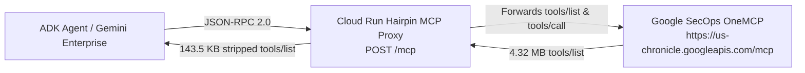

# Deploying a Hairpin MCP proxy for Gemini Enterprise

When you connect an agent directly to the Google Security Operations OneMCP server at `https://us-chronicle.googleapis.com/mcp`, the `tools/list` response returns 71 tools totaling 4.32 MB of JSON. Of that payload, 3.91 MB is `outputSchema` and 258 KB is `inputSchema`.

When the Agent Development Kit builds Gemini function declarations from those tools, it sends both `inputSchema` and `outputSchema` to Vertex AI. Vertex AI then rejects the request with `400 INVALID_ARGUMENT` because the combined schemas exceed its schema flattening limit.

A Hairpin MCP proxy on Cloud Run fixes this without requiring client-side tool wrappers. The proxy forwards JSON-RPC 2.0 requests to OneMCP, strips `outputSchema` on `tools/list`, and replaces `inputSchema` with a minimal open object definition. The `tools/list` payload drops from 4.32 MB to 143.5 KB while keeping all 71 tool names and descriptions intact. You then register the Cloud Run URL as a `custom_mcp` connector in Gemini Enterprise.



---

## 1. Prerequisites and IAM setup

Define your project, region, service name, and service account variables first. The Cloud Run service account needs permission to call Chronicle APIs on your behalf when callers do not pass their own OAuth access token.

```bash
PROJECT_ID="your-gcp-project-id"
PROJECT_NUMBER="$(gcloud projects describe "$PROJECT_ID" --format='value(projectNumber)')"
REGION="us-central1"
SERVICE_NAME="secops-hairpin-mcp"
RUNTIME_SA="${PROJECT_NUMBER}-compute@developer.gserviceaccount.com"

gcloud projects add-iam-policy-binding "$PROJECT_ID" \
  --member="serviceAccount:${RUNTIME_SA}" \
  --role="roles/chronicle.viewer" \
  --condition=None
```

If your agents will create cases, run parsers, or modify rules through OneMCP, grant `roles/chronicle.editor` instead of `roles/chronicle.viewer`.

---

## 2. Create the Hairpin MCP service

If you are deploying standalone outside this repository, create a directory with two files: `main.py` and `requirements.txt`.

### `requirements.txt`

```text
fastapi>=0.115.0
google-auth>=2.35.0
httpx>=0.27.0
requests>=2.32.0
uvicorn>=0.32.0
```

### `main.py`

```python
"""Cloud Run Hairpin MCP proxy for Google Security Operations OneMCP."""

import copy
import os
import time
from typing import Any

from fastapi import FastAPI
from fastapi import Header
from fastapi import HTTPException
from fastapi import Request
from fastapi.responses import JSONResponse
from fastapi.responses import Response
import google.auth
import google.auth.transport.requests
import httpx

UPSTREAM_ONEMCP_URL = os.environ.get(
    "UPSTREAM_ONEMCP_URL", "https://us-chronicle.googleapis.com/mcp"
)
DEFAULT_PROJECT_ID = os.environ.get("GCP_PROJECT_ID", "")
CACHE_TTL_SECONDS = 300.0

STRIPPED_INPUT_SCHEMA: dict[str, Any] = {
    "type": "object",
    "additionalProperties": True,
}

app = FastAPI(title="SecOps Hairpin MCP Proxy")
_cached_tools: list[dict[str, Any]] | None = None
_cache_time: float = 0.0


def _resolve_bearer(
    incoming_auth: str | None,
    incoming_forwarded_auth: str | None = None,
) -> str:
  if incoming_forwarded_auth:
    token = incoming_forwarded_auth.removeprefix("Bearer ").strip()
    if token:
      return f"Bearer {token}"
  if incoming_auth:
    token = incoming_auth.removeprefix("Bearer ").strip()
    if token and not token.startswith("eyJ"):
      return f"Bearer {token}"
  creds, _ = google.auth.default(
      scopes=["https://www.googleapis.com/auth/cloud-platform"]
  )
  creds.refresh(google.auth.transport.requests.Request())
  return f"Bearer {creds.token}"


def _upstream_headers(
    auth: str | None,
    forwarded_auth: str | None,
    user_project: str | None,
    session_id: str | None,
) -> dict[str, str]:
  headers = {
      "Authorization": _resolve_bearer(auth, forwarded_auth),
      "Content-Type": "application/json",
      "Accept": "application/json, text/event-stream",
      "x-goog-user-project": user_project or DEFAULT_PROJECT_ID,
  }
  if session_id:
    headers["Mcp-Session-Id"] = session_id
  return headers


def _strip_tool(tool: dict[str, Any]) -> dict[str, Any]:
  cleaned = copy.copy(tool)
  cleaned.pop("outputSchema", None)
  cleaned["inputSchema"] = dict(STRIPPED_INPUT_SCHEMA)
  return cleaned


async def _fetch_tools(headers: dict[str, str]) -> list[dict[str, Any]]:
  global _cached_tools, _cache_time
  now = time.monotonic()
  if _cached_tools is not None and (now - _cache_time) < CACHE_TTL_SECONDS:
    return _cached_tools

  rpc_req = {
      "jsonrpc": "2.0",
      "id": "hairpin-tools-list",
      "method": "tools/list",
      "params": {},
  }
  async with httpx.AsyncClient(timeout=60.0) as client:
    resp = await client.post(UPSTREAM_ONEMCP_URL, headers=headers, json=rpc_req)
    resp.raise_for_status()
    tools = resp.json().get("result", {}).get("tools", [])

  if isinstance(tools, list) and tools:
    _cached_tools = tools
    _cache_time = now
  return tools


async def _forward_rpc(
    payload: dict[str, Any],
    headers: dict[str, str],
) -> dict[str, Any] | None:
  method = payload.get("method", "")
  rpc_id = payload.get("id")

  if method.startswith("notifications/"):
    return None
  if method == "ping":
    return {"jsonrpc": "2.0", "id": rpc_id, "result": {}}
  if method == "tools/list":
    raw_tools = await _fetch_tools(headers)
    stripped = [
        _strip_tool(t) if isinstance(t, dict) else t for t in raw_tools
    ]
    return {"jsonrpc": "2.0", "id": rpc_id, "result": {"tools": stripped}}

  async with httpx.AsyncClient(timeout=60.0) as client:
    resp = await client.post(UPSTREAM_ONEMCP_URL, headers=headers, json=payload)
    if resp.status_code == 204 or not resp.content:
      return None
    resp.raise_for_status()
    return resp.json()


@app.get("/healthz")
async def healthz() -> dict[str, str]:
  return {"status": "ok", "upstream_url": UPSTREAM_ONEMCP_URL}


@app.post("/mcp")
async def handle_mcp(
    request: Request,
    authorization: str | None = Header(default=None),
    x_forwarded_authorization: str | None = Header(default=None),
    x_goog_user_project: str | None = Header(default=None),
    mcp_session_id: str | None = Header(default=None),
) -> Response:
  payload = await request.json()
  headers = _upstream_headers(
      authorization,
      x_forwarded_authorization,
      x_goog_user_project,
      mcp_session_id,
  )
  if isinstance(payload, list):
    results = []
    for item in payload:
      if isinstance(item, dict):
        res = await _forward_rpc(item, headers)
        if res is not None:
          results.append(res)
    if not results:
      return Response(status_code=202)
    return JSONResponse(content=results)

  res = await _forward_rpc(payload, headers)
  if res is None:
    return Response(status_code=202)
  return JSONResponse(content=res)
```

---

## 3. Deploy to Cloud Run with IAM authentication

Deploy the proxy to Cloud Run with `--no-allow-unauthenticated` and grant `roles/run.invoker` only to authorized service accounts and users (including the Discovery Engine service agent and Vertex AI Agent Engine runtime service agent):

```bash
PROJECT_ID="your-gcp-project-id"
PROJECT_NUMBER="$(gcloud projects describe "$PROJECT_ID" --format='value(projectNumber)')"
REGION="us-central1"
SERVICE_NAME="secops-hairpin-mcp"
CALLER_ACCOUNT="user@example.com"

gcloud run deploy "$SERVICE_NAME" \
  --project="$PROJECT_ID" \
  --region="$REGION" \
  --source=. \
  --command="uvicorn" \
  --args="main:app,--host=0.0.0.0,--port=8080" \
  --set-env-vars="GCP_PROJECT_ID=${PROJECT_ID},UPSTREAM_ONEMCP_URL=https://us-chronicle.googleapis.com/mcp" \
  --no-allow-unauthenticated

for MEMBER in \
  "user:${CALLER_ACCOUNT}" \
  "serviceAccount:${PROJECT_NUMBER}-compute@developer.gserviceaccount.com" \
  "serviceAccount:service-${PROJECT_NUMBER}@gcp-sa-aiplatform-re.iam.gserviceaccount.com" \
  "serviceAccount:service-${PROJECT_NUMBER}@gcp-sa-discoveryengine.iam.gserviceaccount.com"; do
  gcloud run services add-iam-policy-binding "$SERVICE_NAME" \
    --project="$PROJECT_ID" \
    --region="$REGION" \
    --member="$MEMBER" \
    --role="roles/run.invoker"
done

SERVICE_URL="$(gcloud run services describe "$SERVICE_NAME" \
  --project="$PROJECT_ID" \
  --region="$REGION" \
  --format='value(status.url)')"
HAIRPIN_MCP_URL="${SERVICE_URL}/mcp"
echo "Hairpin MCP URL: $HAIRPIN_MCP_URL"
```

Verify that unauthenticated requests are rejected (`403`) and that an OIDC ID token (`gcloud auth print-identity-token`) returns all 71 tools with stripped schemas:

```bash
ID_TOKEN="$(gcloud auth print-identity-token)"
ACCESS_TOKEN="$(gcloud auth print-access-token)"

curl -s -X POST "$HAIRPIN_MCP_URL" \
  -H "Authorization: Bearer ${ID_TOKEN}" \
  -H "X-Forwarded-Authorization: Bearer ${ACCESS_TOKEN}" \
  -H "Content-Type: application/json" \
  -d '{"jsonrpc":"2.0","id":1,"method":"tools/list","params":{}}' \
  | python3 -c "import sys, json; raw=sys.stdin.read(); d=json.loads(raw); print('Tools:', len(d['result']['tools']), 'Bytes:', len(raw))"
```

---

## 4. Register the Hairpin MCP proxy as a Gemini Enterprise connector

Register the Cloud Run endpoint in Discovery Engine using `collections:setUpDataConnector` with `dataSource: "custom_mcp"`. Discovery Engine creates the data connector and syncs it into the Gemini Enterprise Agent Registry catalog.

```bash
PROJECT_ID="your-gcp-project-id"
PROJECT_NUMBER="$(gcloud projects describe "$PROJECT_ID" --format='value(projectNumber)')"
COLLECTION_ID="secops-hairpin-mcp"
DISPLAY_NAME="SecOps Hairpin MCP (Schema Stripped)"
HAIRPIN_MCP_URL="https://secops-hairpin-mcp-123456789012.us-central1.run.app/mcp"
ACCESS_TOKEN="$(gcloud auth print-access-token)"

curl -s -X POST \
  "https://discoveryengine.googleapis.com/v1alpha/projects/${PROJECT_NUMBER}/locations/global:setUpDataConnector" \
  -H "Authorization: Bearer ${ACCESS_TOKEN}" \
  -H "Content-Type: application/json" \
  -H "x-goog-user-project: ${PROJECT_ID}" \
  -d "{
    \"collectionId\": \"${COLLECTION_ID}\",
    \"collectionDisplayName\": \"${DISPLAY_NAME}\",
    \"dataConnector\": {
      \"dataSource\": \"custom_mcp\",
      \"params\": {
        \"oauth_access_token\": \"unused\"
      },
      \"actionConfig\": {
        \"actionParams\": {
          \"auth_type\": \"NO_AUTH\",
          \"instance_uri\": \"${HAIRPIN_MCP_URL}\",
          \"mcp_server_source\": \"BYO_MCP\"
        }
      },
      \"connectorModes\": [\"FEDERATED\", \"ACTIONS\"]
    }
  }"
```

---

## 5. Verify the Gemini Enterprise connection

Confirm that Discovery Engine created the connector and that Agent Registry indexed the MCP server:

```bash
PROJECT_ID="your-gcp-project-id"
COLLECTION_ID="secops-hairpin-mcp"
ACCESS_TOKEN="$(gcloud auth print-access-token)"

# 1. Inspect the Discovery Engine dataConnector
curl -s \
  "https://discoveryengine.googleapis.com/v1alpha/projects/${PROJECT_ID}/locations/global/collections/${COLLECTION_ID}/dataConnector" \
  -H "Authorization: Bearer ${ACCESS_TOKEN}" \
  -H "X-Goog-User-Project: ${PROJECT_ID}" | jq '{name, state, dataSource, actionConfig}'

# 2. List synced MCP servers in Agent Registry
curl -s \
  "https://agentregistry.googleapis.com/v1alpha/projects/${PROJECT_ID}/locations/global/mcpServers" \
  -H "Authorization: Bearer ${ACCESS_TOKEN}" \
  -H "X-Goog-User-Project: ${PROJECT_ID}" | jq '.mcpServers[] | {name, displayName, attributes}'
```

Once registered, an ADK agent can attach the IAM-protected Hairpin MCP endpoint with `McpToolset` by supplying an OIDC ID token in `Authorization` and forwarding the OAuth 2.0 access token in `X-Forwarded-Authorization`:

```python
import urllib.parse
import google.auth
import google.auth.transport.requests
from google.adk.agents import Agent
from google.adk.models import Gemini
from google.adk.tools.mcp_tool.mcp_session_manager import (
    StreamableHTTPConnectionParams,
)
from google.adk.tools.mcp_tool.mcp_toolset import McpToolset
from google.oauth2 import id_token

HAIRPIN_MCP_URL = "https://secops-hairpin-mcp-123456789012.us-central1.run.app/mcp"
PROJECT_ID = "your-gcp-project-id"


def build_cloud_run_mcp_headers(target_url: str) -> dict[str, str]:
  creds, _ = google.auth.default(
      scopes=["https://www.googleapis.com/auth/cloud-platform"]
  )
  req = google.auth.transport.requests.Request()
  creds.refresh(req)
  oidc_tok = getattr(creds, "id_token", None)
  if not isinstance(oidc_tok, str) or not oidc_tok:
    parsed = urllib.parse.urlparse(target_url)
    audience = f"{parsed.scheme}://{parsed.netloc}"
    oidc_tok = id_token.fetch_id_token(req, audience)
  return {
      "Authorization": f"Bearer {oidc_tok}",
      "X-Forwarded-Authorization": f"Bearer {creds.token}",
      "X-Goog-User-Project": PROJECT_ID,
  }


agent = Agent(
    name="secops_agent",
    model=Gemini(model="gemini-2.5-flash"),
    tools=[
        McpToolset(
            connection_params=StreamableHTTPConnectionParams(
                url=HAIRPIN_MCP_URL,
                headers=build_cloud_run_mcp_headers(HAIRPIN_MCP_URL),
                timeout=30.0,
            ),
            header_provider=lambda _ctx: build_cloud_run_mcp_headers(
                HAIRPIN_MCP_URL
            ),
        )
    ],
)
```
